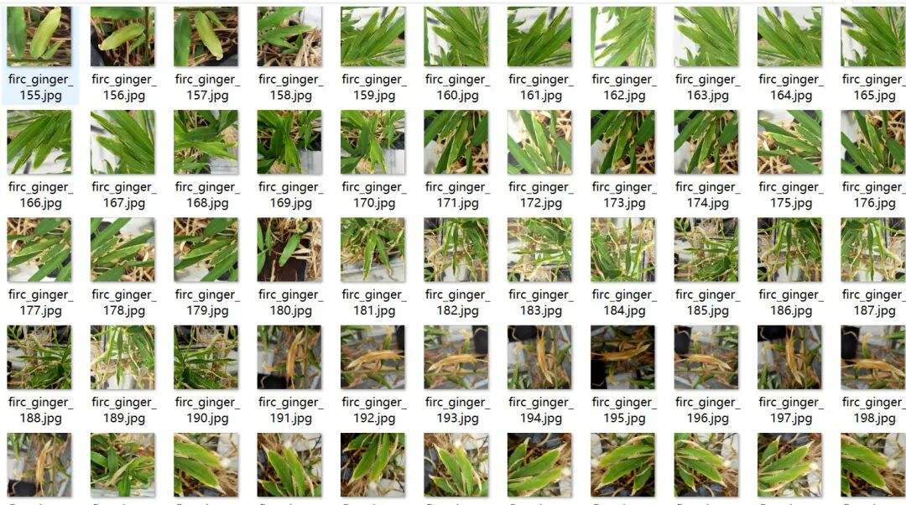
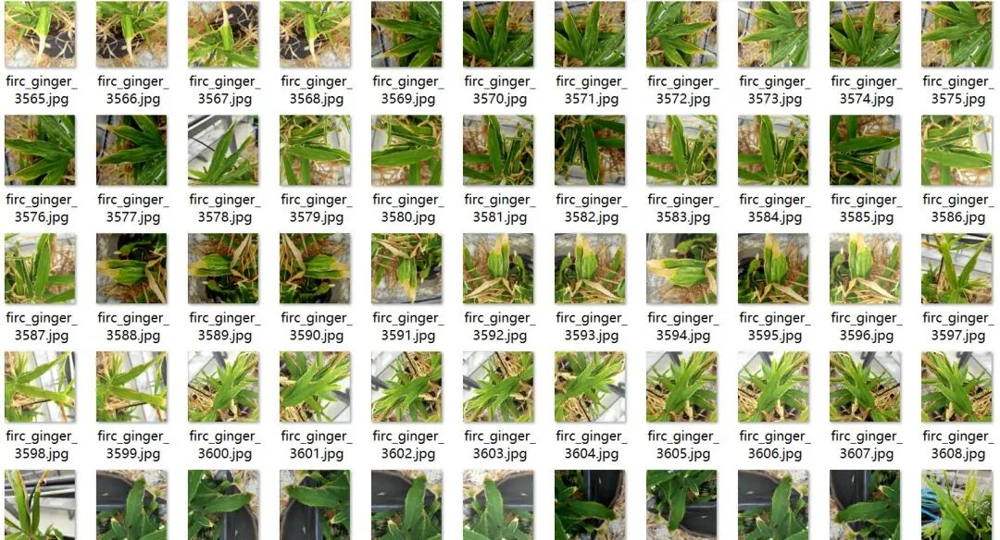
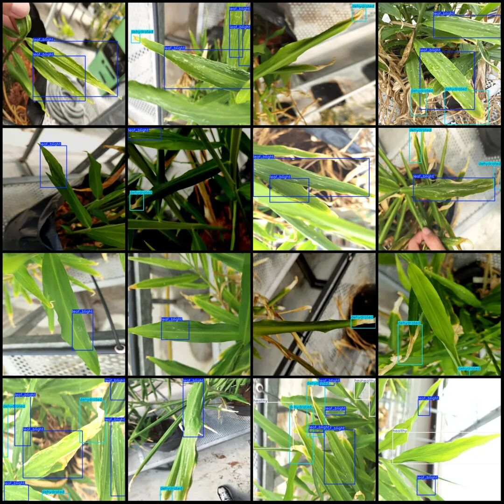

# Leek Leaf Disease Detection Dataset VOC+YOLO format with 5515 images in 4 categories

Approximately 2300 images in the dataset are original and the rest are enhanced.

Dataset format: Pascal VOC format + YOLO format (txt file without split path, only containing jpg images and corresponding VOC format xml files and yolo format txt files)

Number of images (number of jpg files): 5515

Number of annotations (number of xml files): 5515

Number of annotations (number of txt files): 5515

Labeling category count: 4

Label category names (note that the order of yolo format categories does not correspond to this, but is based on the labels folder's classes.txt): ["damage_pest", "dehydrated", "healthy", "leaf_blight"]

Number of boxes labeled in each category:

damage_pest(Pest) = 841

Dehydrated (dehydration) frame count = 8017

Healthy (health) Frames = 1745

Leaf blight (leaf rot) frame count = 11710

Total frame count: 22313

Using labelImg:

Annotation rules: Draw a rectangle around the category.

Image resolution: 640x640

Important Notice: No

Special : This dataset does not guarantee the accuracy of the trained models or weight files.

Image Preview:

Annotation example:

## Payment

Here is a pay link on Stripe ( https://buy.stripe.com/3cs8yP7sY87d0vu9AB ). Please contact me lonlonago@foxmail.com after funding $89, and I will send you a complete data files , thank you!

